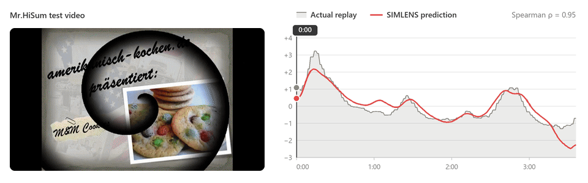
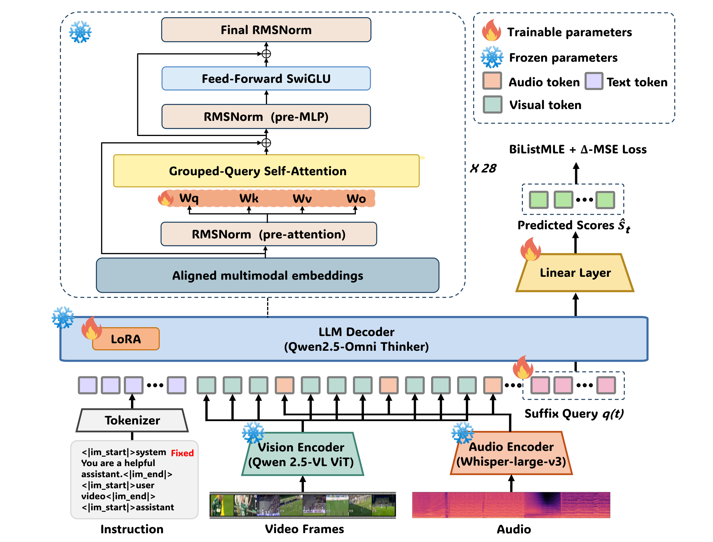

<h1 align="center">SIMLENS: Sound-Informed Multimodal LLMs for Full-Curve Video Engagement Prediction</h1>

<p align="center">
  Ren-Siang Wei<sup>*</sup>, Sheng-You Fu<sup>*</sup>, Yen-Liang Chen<sup>†</sup><br>
  <b>WACV 2027</b><br>
  <sub><sup>*</sup> Equal contribution. <sup>†</sup> Corresponding author.</sub>
</p>

<p align="center">
  <a href="https://box755.github.io/simlens-page/"><b>Project page and demo</b></a> ·
  Paper (coming soon) ·
  arXiv (coming soon) ·
  <a href="#checkpoints">Checkpoints</a> ·
  <a href="#yt-fresh">YT-Fresh dataset</a>
</p>

YouTube's **Most Replayed** curve shows the relative replay intensity across a video, but it is only available after publication. SIMLENS predicts this curve from the video's frames and audio, with one replay score per second.

<p align="center">
  
</p>

<p align="center"><sub>SIMLENS prediction (red) and the recorded Most Replayed curve (grey) for a Mr.HiSum test video, shown at about 24× speed. More examples are on the <a href="https://box755.github.io/simlens-page/">project page</a>.</sub></p>

## Overview

- **Audio-visual backbone.** SIMLENS adapts Qwen2.5-Omni-7B with LoRA. Frames and audio are interleaved in one-second blocks, and only 0.11% of the parameters (10.1 M) are trained.
- **Suffix-query readout.** One query token per second is appended after the video. The tokens share one learned embedding, and each can attend to the whole video. The model predicts the full curve in one forward pass.
- **Bidirectional listwise loss.** The training objective learns the ranking of seconds within each video, with supervision from both the high-replay and the low-replay end.

On the Mr.HiSum test subset, SIMLENS reaches 77.5 mAP@50, 11.1 points above the strongest baseline evaluated on the same videos, and its per-video Spearman correlation is 0.527. We also evaluate the same checkpoints on YTMR500 and on [YT-Fresh](#yt-fresh), our set of 1,230 recent videos, without training or tuning on either.

<p align="center"></p>

## Quick start

SIMLENS requires a CUDA GPU and FFmpeg (on `PATH`, or set `SIMLENS_FFMPEG` to the binary). Our tested setup is Python 3.11 and PyTorch 2.11.0 with CUDA 12.8 on Windows 11, with one RTX 5090 (32 GB).

On that setup, inference on a 300-second video used about 20 GB of GPU memory, and inference also ran under Python 3.13. Other systems and GPUs have not been tested.

```bash
git clone https://github.com/box755/SIMLENS-Model.git
cd SIMLENS-Model
python -m venv .venv
.venv\Scripts\Activate.ps1        # Windows PowerShell. On Linux or macOS: source .venv/bin/activate
python -m pip install torch==2.11.0 torchvision==0.26.0 --index-url https://download.pytorch.org/whl/cu128
python -m pip install -e .
python scripts/download_checkpoints.py --seed 42
```

Install PyTorch with the command above before `pip install -e .`, so that the CUDA build is used. If SIMLENS later reports that it needs a CUDA GPU, see [Troubleshooting](#troubleshooting).

**Predict the curve of one video**

```bash
simlens-predict --video my_video.mp4 --checkpoint checkpoints/seed42 --out outputs/my_video.json
```

The first run downloads the Qwen2.5-Omni-7B backbone from Hugging Face (about 21 GB). The command saves one replay score per second to `outputs/my_video.json` and `outputs/my_video.csv`. Scores indicate relative replay intensity **within the input video**; they are not probabilities and cannot be compared across videos.

<details>
<summary>Example JSON output</summary>

For a three-second video:

```json
{
  "video_id": "my_video",
  "s_hat": [0.46875, 0.53515625, 0.55859375],
  "n_seconds": 3,
  "max_input_seconds": 300,
  "score_scale": "relative replay intensity; not a probability",
  "position_settings": {
    "processor_chunk_seconds": 1.0,
    "positional_chunk_seconds": 2,
    "position_ids_per_second": 25,
    "backbone_revision": "ae9e1690543ffd5c0221dc27f79834d0294cba00"
  }
}
```

</details>

The model reads frames at 2 fps (112×112 pixels) and 16 kHz mono audio. It does not use the title, a transcript or any other text about the video. Only the first 300 seconds are read by default; pass `--max-sec 1380` for longer videos if GPU memory allows.

**Run the demo locally**

The demo uses the same environment as above.

```bash
python -m pip install -e ".[demo]"
python demo/server.py --checkpoint checkpoints/seed42
```

When `[demo] model ready` appears, open http://127.0.0.1:7860 and upload a video. The page plays the video above its predicted curve and exports the scores as JSON or CSV. `python demo/server.py --mock` shows the interface without a GPU, using made-up curves. The demo is meant for local use; see [demo/README.md](demo/README.md) before exposing it to a network.

## Checkpoints

Three checkpoints of the full model, trained with different seeds, are on the [Releases](https://github.com/box755/SIMLENS-Model/releases/tag/v0.1.0) page. `python scripts/download_checkpoints.py --seed all` downloads and verifies them.

| Seed | Download | mAP@50 | mAP@15 | Spearman |
|---|---|---:|---:|---:|
| 42 | [simlens-seed42-v0.1.0.zip](https://github.com/box755/SIMLENS-Model/releases/download/v0.1.0/simlens-seed42-v0.1.0.zip) | 77.95 | 49.28 | 0.533 |
| 7 | [simlens-seed7-v0.1.0.zip](https://github.com/box755/SIMLENS-Model/releases/download/v0.1.0/simlens-seed7-v0.1.0.zip) | 77.47 | 49.08 | 0.527 |
| 123 | [simlens-seed123-v0.1.0.zip](https://github.com/box755/SIMLENS-Model/releases/download/v0.1.0/simlens-seed123-v0.1.0.zip) | 77.11 | 48.02 | 0.522 |
| Mean ± std | | 77.51 ± 0.42 | 48.79 ± 0.68 | 0.527 ± 0.006 |

Results on the Mr.HiSum test subset (1,874 videos, see [Data](#data)). Each checkpoint is evaluated separately and the last row summarizes the three seeds; they are not an ensemble. The commands in this README use seed 42.

Each checkpoint (about 37 MB) contains the LoRA adapter, the linear prediction head and the shared query embedding. The Qwen2.5-Omni-7B backbone is downloaded separately from Hugging Face, at the revision pinned in the config. Checkpoints of the ablation variants are not released.

<details>
<summary>Files in a checkpoint</summary>

| File | Content |
|---|---|
| `adapter_model.safetensors`, `adapter_config.json` | the LoRA adapter |
| `head.pt` | the linear head and the query embedding; needed together with the adapter |
| `model_config.yaml` | the configuration the checkpoint was trained with |
| `meta.json` | validation metrics at the selected training step (not test results) |
| `MODEL_CARD.md`, `LICENSE` | description and license |

</details>

The table below summarizes the three-seed results on Mr.HiSum and the zero-shot results on YTMR500 and YT-Fresh.

| Dataset | Videos | mAP@50 | Spearman |
|---|---:|---:|---:|
| Mr.HiSum (test) | 1,874 | 77.51 ± 0.42 | 0.527 ± 0.006 |
| YTMR500 (zero-shot) | 406 | 69.00 ± 1.77 | 0.353 ± 0.045 |
| YT-Fresh (zero-shot) | 1,230 | 72.69 ± 0.10 | 0.435 ± 0.004 |

## Data

No videos are redistributed. `datasets/` holds the small files we release. Downloaded videos and labels go under `data/`; [docs/data.md](docs/data.md) explains the layout.

| Dataset | Used for | Videos used | Released here | Get the rest from |
|---|---|---|---|---|
| Mr.HiSum | training, validation, test | 26,132 / 1,867 / 1,874 | the IDs of the videos we used | [MR.HiSum](https://github.com/MRHiSum/MR.HiSum) (labels, split), YouTube (videos) |
| YTMR500 | zero-shot test | 406 of 500 | the IDs of the videos we used | [most-replayed-data](https://github.com/ombretta/most-replayed-data) |
| YT-Fresh (ours) | zero-shot test | 1,230 | video IDs, Most Replayed curves, metadata | YouTube (videos) |

### Mr.HiSum

SIMLENS uses raw video and audio rather than the features released with Mr.HiSum, so the videos have to be downloaded again. We recovered 29,873 of the original 31,892 videos and kept their official split assignments. SIMLENS and the baselines we evaluated share the same 1,874-video test subset; results quoted from other papers keep the coverage reported there.

Video availability changes over time, so the subset you can download may differ from ours. `datasets/splits/` lists the IDs we used, and [datasets/README.md](datasets/README.md) shows how to run on exactly these videos.

### YT-Fresh

YT-Fresh is our test set for zero-shot evaluation on recent uploads: 1,230 YouTube videos uploaded between July 2023 and August 2026, with their metadata and recorded Most Replayed curves. 850 of them were uploaded after the backbone's public release, so they cannot be part of its pretraining data. None of the videos is used for training or tuning.

The files are in `datasets/ytfresh/` and are licensed under CC BY 4.0. [datasets/ytfresh/README.md](datasets/ytfresh/README.md) describes them, how the set was collected, and how to predict and score it.

## Training and evaluation

Both steps need the Mr.HiSum files under `data/mrhisum/` and the official Mr.HiSum metric code; [docs/data.md](docs/data.md) explains the setup. Run the commands from the repository root.

### Evaluate a released checkpoint

```bash
simlens-evaluate --config simlens/configs/main.yaml --ckpt checkpoints/seed42 --split test
simlens-score --pred outputs/simlens_s42/eval_test/predictions.jsonl --gt mrhisum --gt-file data/mrhisum/mr_hisum.h5 --out outputs/mrhisum_scores.json
```

The first command predicts every test video it finds in `data/mrhisum/videos` and writes `outputs/simlens_s42/eval_test/predictions.jsonl`. The second computes the paper's metrics from that file. On one RTX 5090 (32 GB), evaluation took about 2.6 seconds per test video.

The output folder is named after `run_name` in the config. Before evaluating another checkpoint with the same config, change `run_name`, or the earlier predictions are overwritten.

### Train

```bash
simlens-train --config simlens/configs/main.yaml --seed 42 --run-name my_run
```

Training runs for one epoch (about 6,500 steps) and took 20–31 hours on one RTX 5090 (32 GB). The checkpoint with the best validation Spearman is saved to `outputs/my_run/checkpoints/lora_best`, and it is evaluated on the test split when training ends. `simlens-train` also accepts `--set key=value` to change a setting from the command line.

GPU operations can be non-deterministic, so rerunning with the same seed may not reproduce the results exactly.

The ablations in the paper's Table 4 use these configs:

| Config | Paper, Table 4 |
|---|---|
| `main.yaml` | SIMLENS (full) |
| `without_audio.yaml` | w/o audio |
| `causal_readout.yaml` | causal readout |
| `pointwise_loss.yaml` | pointwise loss |
| `hybrid_loss.yaml` | hybrid loss |
| `without_valley_pass.yaml` | w/o valley pass |
| `prior_style.yaml` | prior-style control |

The two readout-only rows in Table 1 use `readout_only.yaml` (video and audio) and `readout_only_without_audio.yaml` (video only). They keep the whole backbone frozen, LoRA included, and train only the linear head and the query embedding for at most 1,500 steps.

[docs/reproducibility.md](docs/reproducibility.md) covers checkpoint selection, metric definitions and other implementation details.

## Limitations

- A low predicted score does not mean viewers will skip that moment. The curve can point an editor to parts worth a second look; automatic trimming has not been evaluated.
- The model is trained on videos of two to five minutes. Accuracy is lower on YTMR500, where the median video is about ten minutes, but that set also differs in content, so the drop cannot be attributed to length alone.
- All results are for one backbone, Qwen2.5-Omni-7B.
- The code groups the input in one-second blocks in the processor but keeps the backbone's two-second positional grouping, as in the implementation the paper describes. Changing either setting has not been validated with the released checkpoints; see [docs/reproducibility.md](docs/reproducibility.md).

More detail is in the [model card](docs/model_card.md).

## Troubleshooting

- **`RuntimeError: SIMLENS inference requires a CUDA GPU with cuDNN SDPA support`.** SIMLENS raises this when `torch.cuda.is_available()` is false. Check with `python -c "import torch; print(torch.__version__, torch.cuda.is_available())"`. If the version ends in `+cpu`, the CPU-only build of PyTorch is installed: run `python -m pip uninstall -y torch torchvision`, then install PyTorch again with the command in [Quick start](#quick-start). Otherwise, check the GPU driver and that the GPU is visible to PyTorch.
- **`ffmpeg not found`.** Install FFmpeg and put it on `PATH`, or set the environment variable `SIMLENS_FFMPEG` to the full path of the binary.
- **`Official Mr.HiSum code not found`.** `simlens-evaluate` and `simlens-score` use the metric code of the Mr.HiSum repository. Clone it as described in [docs/data.md](docs/data.md), or set `MRHISUM_ROOT` to an existing copy.

## Citation

```bibtex
@inproceedings{wei2027simlens,
  title     = {{SIMLENS}: Sound-Informed Multimodal {LLMs} for Full-Curve Video Engagement Prediction},
  author    = {Wei, Ren-Siang and Fu, Sheng-You and Chen, Yen-Liang},
  booktitle = {Proceedings of the IEEE/CVF Winter Conference on Applications of Computer Vision (WACV)},
  year      = {2027}
}
```

## License and acknowledgements

Copyright 2026 Ren-Siang Wei, Sheng-You Fu and Yen-Liang Chen. The code and the released checkpoints are licensed under [Apache-2.0](LICENSE), and the YT-Fresh files in `datasets/ytfresh/` under [CC BY 4.0](https://creativecommons.org/licenses/by/4.0/). The Qwen2.5-Omni-7B backbone is downloaded separately under its own Apache-2.0 license, and each dataset keeps its own terms; see [THIRD_PARTY_NOTICES.md](THIRD_PARTY_NOTICES.md).

SIMLENS builds on [Qwen2.5-Omni](https://github.com/QwenLM/Qwen2.5-Omni), [PEFT](https://github.com/huggingface/peft) and [Transformers](https://github.com/huggingface/transformers), and is evaluated with [Mr.HiSum](https://github.com/MRHiSum/MR.HiSum) and [YTMR500](https://github.com/ombretta/most-replayed-data). We thank their authors.

Contact: ylchen@mgt.ncu.edu.tw
